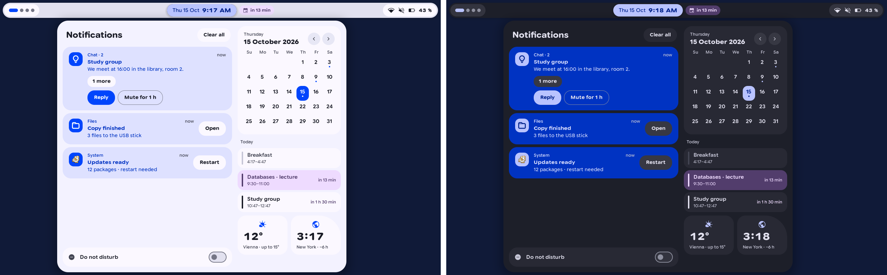
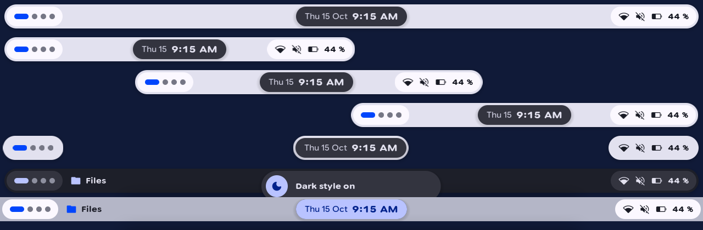
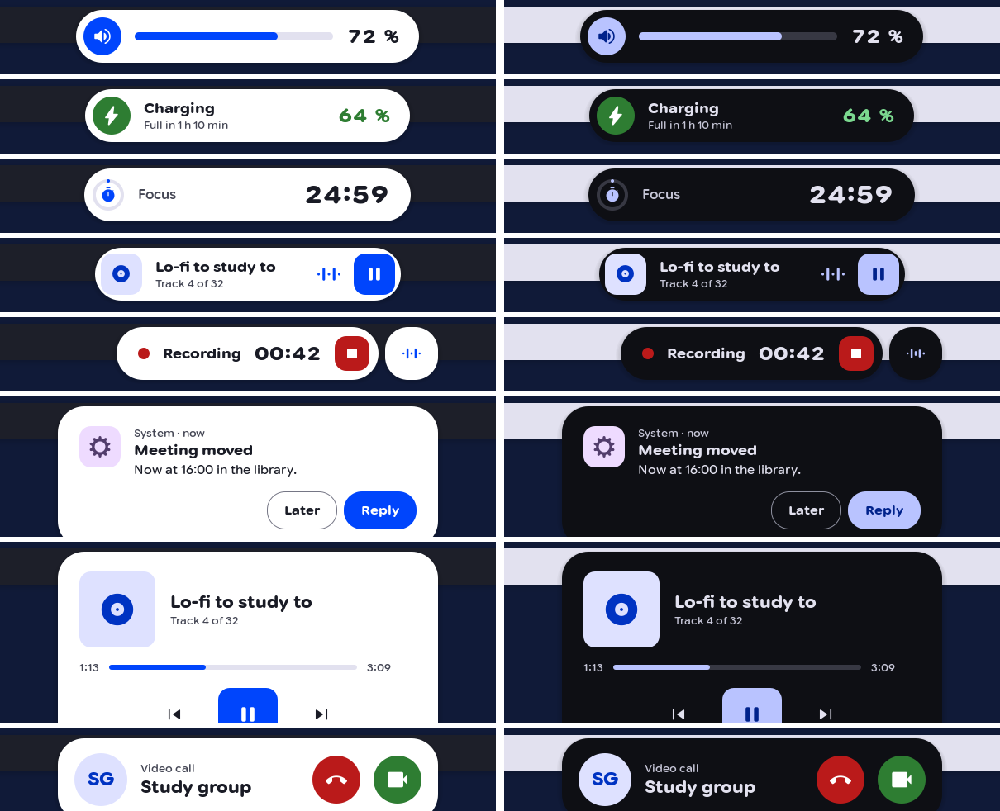
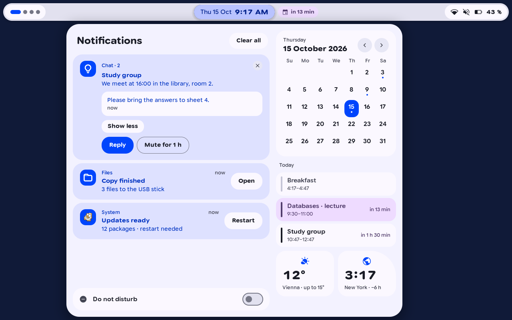
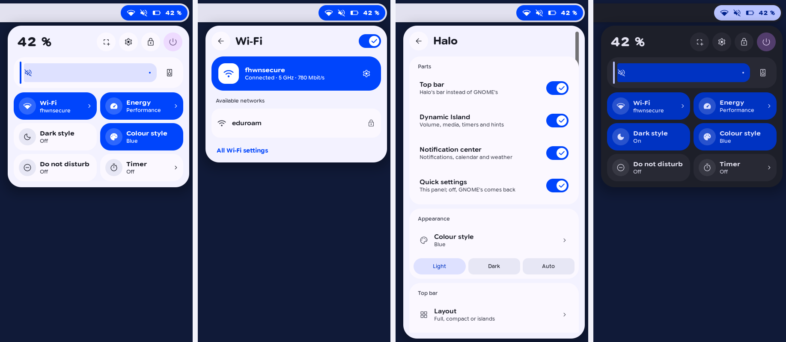
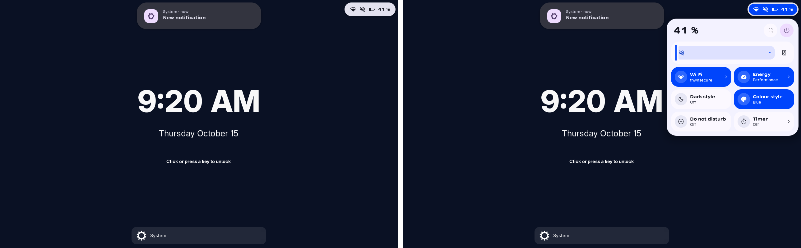
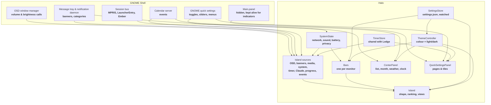

<div align="center">
  <h1>Halo</h1>
  <p><strong>A top bar, a Dynamic Island, a notification center and quick settings for GNOME Shell in Toms Expressive Design, each one switchable on its own.</strong></p>

  <p>
    
    
    
    
    
    
  </p>
</div>

---



**Halo** replaces four parts of **GNOME Shell 50**: the top bar, the volume and brightness pop-ups with the notification banners, the date menu, and the quick settings. It draws its own versions in **Toms Expressive Design** and moves them with springs, but it reads everything from GNOME's own models: Wi-Fi, Bluetooth, sound, power, notifications and the calendar stay GNOME's, so nothing is implemented twice.

Each of the four parts can be switched off in Halo's settings. GNOME's own part comes back in its place at once.

---

## Features

- **Floating Top Bar:** **44 px** high, **8 px** from the edges, in five layouts (see [The Top Bar](#the-top-bar)). Workspace dots on the left, the focused app beside them, date and time in the middle, privacy and status on the right.
- **Dynamic Island:** The clock is the island. Volume, a notification, a call, music, a timer or a recording grow out of it and shrink back into it (see [The Dynamic Island](#the-dynamic-island)).
- **Notification Center:** A click on the clock opens a wide card under it: notifications grouped by app and conversation, the month with event dots, today's events, the weather and a world clock (see [The Notification Center](#the-notification-center)).
- **Quick Settings:** Sliders, tiles and pages for Wi-Fi, Bluetooth, energy, appearance, VPN, sound, power and a timer. Every other extension's top bar icon becomes a tile here, and Halo's own settings live behind the gear (see [Quick Settings](#quick-settings)).
- **Colour Style for the Family:** Eight colour styles. Choosing one also sets it in **Harbor**, **Tally**, **Ember**, **Torch** and **Ledge** if they are installed.
- **Dark Style on a Schedule:** **Light**, **Dark** or **Auto** between two times you set; Halo sets GNOME's colour scheme.
- **Lock Screen:** Halo stays on the lock screen with only what belongs there (see [The Lock Screen](#the-lock-screen)).
- **Every Monitor:** A bar on every monitor; the island, the center and the quick settings on the main one.

---

## The Top Bar



| Layout | What it looks like |
| :--- | :--- |
| **Full** | One floating bar across the screen; the default. The focused app's symbol and name sit beside the workspace dots. |
| **Compact left / centre / right** | A bar half as wide at one side or in the middle. |
| **Islands** | No bar, only three separate pills over the wallpaper. |

- **Workspace Pill:** One dot per workspace; the current one is long and glides when you switch. Click a dot to switch, scroll on the pill to step through, click the rest of the pill for the overview. In the overview the pill says **Overview**.
- **Clock:** Date and time, an unread dot, and a chip **in 10 min** when an event of today starts within the hour.
- **Status Pill:** Network, sound and battery with its percentage, red under **20 %**. A recording shows its time, and camera, microphone and screen sharing each get a pill while they are in use.
- **Options:** **See-through**, **Light bar** (stays light on a dark desktop), **Hide in fullscreen** (back when you push the pointer against the top edge), **Floating** off (the bar sits on the edge like GNOME's).

| Mode | What stays on screen |
| :--- | :--- |
| **Bar** | The top bar with the island in its clock; the default. |
| **Only the island** | No bar: windows get the whole screen, and the clock island alone reaches into them. A drag or a two-finger swipe up on it hides it for **5, 10, 20, 30 or 60 s** (default **10 s**); hints still come meanwhile. |
| **Only a handle** | A thin grip at the top edge. Resting on it brings the clock island out; it goes back a moment after the pointer leaves. Everything the island shows grows out of the grip; something running goes back into it after its intro and leaves a dot beside it. |

In both hidden modes, pushing the pointer up against the top edge brings the bar down until the pointer leaves it. On the lock screen the bar is always there.
- **No Foreign Icons:** Indicators of other extensions and tray icons do not go into the bar. Each becomes a tile in the quick settings whose page shows its menu.

---

## The Dynamic Island



The island rests on the clock, a few pixels lower, so it reaches into the window below. It is always the opposite of the desktop: white on a dark desktop, black on a light one. When something happens it grows out of the clock to about twice its size with a spring that overshoots a little; its content fades in without one.

- **Click:** Opens the thing's app: Claude's window or the terminal its session runs in, the music player, the app behind a download. Halo's settings can make a click open the large look first instead; the middle button always opens it. A right click closes it or sends the thing away. Something still going (music, a timer, a recording) then waits as a small circle beside the island, or beside the clock when nothing else shows; a click on the circle brings it back, and a right click on the clock brings back everything sent away.
- **Hover:** The pointer on a short message holds it. Under the pointer a small look grows a little wider and longer, its text kept at its size. On the resting clock it shows the weather and the next event of today below the time. Resting on it for a moment shows one more line, with a bar for music and timers: the player and the track's time, when the timer ends, which projects Claude works on, the app behind a download.
- **Two at Once:** The more important lasting thing takes the island; the other waits beside it as a small bubble. A click on the bubble, a sideways touchpad swipe or Shift with the wheel swaps them.
- **Scroll:** On music the wheel or two fingers change the volume; on a timer they add or take a minute.
- **While the Center Is Open:** The clock has become the center, so the island rests as a small circle with a pencil, which opens the island's settings. An event grows out of that circle.

| Event | Where it comes from | Kind |
| :--- | :--- | :--- |
| **Volume, brightness, mute** | GNOME's OSD calls (the volume and brightness keys); GNOME's own pop-up stays away | Short |
| **Notifications** | GNOME's message tray, where it would show a banner; Do not disturb and urgency still decide | Short; critical ones with actions stay |
| **Calls** | Notifications with the category **`call`** (sent over the session bus) | Lasting, first of all |
| **Screen recording** | GNOME's screencast, with a stop button | Lasting |
| **Camera, microphone, screen sharing** | GNOME's privacy indicators | Lasting |
| **Timer, stopwatch, Pomodoro** | The quick settings' timer page, shared with **Ledge** | Lasting |
| **Claude working** | **Ember**'s session bus service; limits at **80 %** and **95 %** from **Tally**'s cache | Lasting / short |
| **Music** | **MPRIS** players, small and large | Lasting |
| **Download and copy progress** | **LauncherEntry** signals that apps such as Files send | Lasting |
| **Charging, low battery** | UPower: plugged in, unplugged, **20 %** and **10 %** | Short |
| **Settings** | Do not disturb, dark style, night light, power mode, keyboard layout | Short |
| **Network and devices** | Wi-Fi and VPN connected or lost, a Bluetooth device with its battery | Short |
| **Event soon** | GNOME's calendar: an event of today about to start | Short |
| **Screenshot, copied text** | The screenshot tool, with a thumbnail; the clipboard, never what password managers mark | Short |
| **Workspace** | A move to another workspace: its name or number and the apps on it | Short |
| **App starting** | An app that starts, until its first window shows (at most **10 s**) | Short |
| **Caps Lock, Num Lock** | The keyboard's lock state | Short |
| **USB drives** | A drive plugged in (a click opens it in Files) or removed | Short |

Lasting things in order: **call**, then **recording** and **privacy**, **timer**, **Claude**, **music**, **progress**. A short message shows over whatever lasts. Every event has its own switch in Halo's settings.

---

## The Notification Center



A click on the clock opens it, and it grows out of the clock as the island does: the clock's shape springs into the card's, and the card's content fades in over it. Closing runs back into the clock. **Super + V**, GNOME's own shortcut, opens it too, instead of the date menu.

- **Groups:** One card per app and conversation. A card with more messages opens with **N more**.
- **Actions:** One action sits beside the text as a pill; more get a row below.
- **Swipe to Dismiss:** A card follows the pointer sideways and goes when it is swiped far or fast enough; otherwise it springs back. While the pointer is on a card, a close button takes the place of its time.
- **New Since Last Time:** Cards that came since the center was last open carry a coloured edge.
- **Clear All and Do Not Disturb:** **Clear all** leaves resident notifications such as a running download. Do not disturb has its own row at the bottom.
- **The Day:** The month with a dot under days that have events (click a day for its events), today's events with the next one marked **in 13 min**, the weather, and the first world clock of **GNOME Clocks**.

---

## Quick Settings



- **Header:** Battery percentage and time left, screenshot, settings, lock, and power with its own page.
- **Sliders:** Volume with an output button, brightness.
- **Tiles:** **Wi-Fi**, **Bluetooth**, **Energy**, **Night light**, **Dark style**, **Colour style**, **Do not disturb**, **VPN**, **Timer**, and a tile for each other extension's top bar icon. A tile with a chevron opens its page.
- **Pages:** Wi-Fi networks, Bluetooth devices with their batteries, energy profiles, appearance with the eight colours, VPN connections, sound outputs, power off, restart, suspend, log out and switch user, the timer.
- **Media and Background Apps:** The player that is playing, and the apps that run without a window.
- **Halo's Settings:** Behind the gear. Appearance, the top bar, the island with one switch per event, the tiles (hide and drag into order), motion, dark style times, and a warning when an extension that changes the same top bar is on (**Transparent Top Bar**, **Top Bar Organizer**, **Blur my Shell**).

---

## The Lock Screen



Halo runs in GNOME's **unlock-dialog** mode as well, like GNOME's own panel:

- **Bar:** Only the status pill stays, standing on its own; GNOME's lock screen shows the clock.
- **GNOME's list:** GNOME's own list of notifications and its media player under the clock stay hidden while the island takes notifications, so nothing shows twice. A new notification still wakes the screen.
- **Island:** Volume, brightness, music, the timer and charging show as usual. A notification shows only its app and **New notification**, or its title where GNOME's notification settings let details show on the lock screen. Calls show **Incoming call** without a name. Claude's work, copied text and events stay out.
- **Notification Center:** Does not open.
- **Quick Settings:** No settings gear, no lock button, no links into GNOME Settings, no list of background apps.

After unlocking, the island shows the notifications that came meanwhile with their content.

---

## Motion

Halo moves like **Harbor**: springs for size and position, short eases for fading.

- **Expressive Motion:** On, things overshoot a little and settle; off, they only fade, quickly and calmly.
- **Speed:** **Quick**, **Normal** or **Slow**.
- **Reduced Animations:** When GNOME's animations are off, Halo's changes happen at once.

---

## Requirements

| Requirement | Why |
| :--- | :--- |
| **GNOME Shell 50** | Halo reaches into the shell's top bar, OSD, message tray and quick settings, which change between versions. Only 50 is named in `metadata.json`. |
| **Wayland session** | Tested only there. |
| **Google Sans Flex** | The typeface of the design. `install.sh` installs the bundled copy if none is installed. |
| **GNOME Clocks, GNOME Weather** (optional) | The world clock comes from Clocks' list; without Ledge, the weather place comes from GNOME Weather. |
| **Ledge, Ember, Tally** (optional) | Shared timer, Claude's state, usage limits. |

---

## What Halo Reads and Writes

| What | Where | Why |
| :--- | :--- | :--- |
| **Settings** | **`~/.config/halo/settings.json`** | Every choice from the settings page. Watched, so an edit by hand takes effect at once. |
| **Timers** | **`~/.local/state/ledge/timers.json`** | Timer, stopwatch and Pomodoro, shared with **Ledge**. |
| **Colour style of the family** | **`~/.config/harbor/settings.json`**, **`~/.config/tally/settings.json`**, Ember's and Torch's session bus services, Ledge's GSettings | Written only when you choose a colour, and only for extensions that are installed and know the colour. |
| **GNOME settings** | **`org.gnome.desktop.interface color-scheme`**, **`org.gnome.desktop.notifications show-banners`** | Dark style and Do not disturb. |
| **Weather** | **`api.open-meteo.com`** | The only network request: the coordinates of Ledge's place, or GNOME Weather's, when the center opens, at most every **30 minutes**. No account and no key. |
| **Usage limits** | **`~/.cache/tally/limits.json`** | Read only, for the island's 80 % and 95 % marks. |
| **Font** | **`~/.local/share/fonts/GoogleSansFlex.woff2`** | Copied by `install.sh` only if no **Google Sans Flex** is installed. |

---

## Installation

```bash
git clone https://github.com/tomsliikee/halo.git
cd halo
./install.sh
```

The script links the extension, installs **Google Sans Flex** if it is missing, and enables Halo. GNOME Shell under Wayland loads a new extension only at the next login, so log out and back in.

```bash
./install.sh --remove
```

removes the link and disables Halo; the settings file stays, and GNOME's own top bar comes back.

**Updating** is `git pull` in the clone and a new login, since the extension is a link to it.

---

## Architecture



Halo shadows a few of GNOME's methods on their instances (the OSD's `_showOsdWindow`, the tray's `_showNotification`, the panel's `toggleCalendar`) and removes the shadow again when a part goes off, so GNOME's own code is never changed in place.

Colours come from **`extension/lib/shared/palettes.js`**: each style is Material 3's **SchemeVibrant** of one seed. Structure is in **`tools/stylesheet.template.css`**, written once per colour and scheme into **`extension/stylesheet.css`** by **`gjs -m tools/build-stylesheet.js`**. Text is set through **Pango** attributes, because St cannot reach the axes of a variable font.

---

## Development

| Task | Command |
| :--- | :--- |
| **Unit tests** | `for t in tests/*.test.js; do gjs -m "$t"; done` |
| **Stylesheet** | `gjs -m tools/build-stylesheet.js` |
| **Icons and symbols** | `gjs -m tools/build-icons.js`, `gjs -m tools/build-symbols.js` |
| **Headless shell** | `tools/headless/run.sh <script> [seconds]` with a script from **`tools/headless/scripts`** (`bar`, `qs`, `island`, `center`, `morph`, `gestures`, `dismiss`, `perf`, `frames`, `click`, `lock`, `lock-input`, `states`, `modes`, `lifecycle`); screenshots land in **`$TMPDIR/halo-headless`** |
| **Dark desktop** | `HALO_SCHEME=dark tools/headless/run.sh center` |
| **Two monitors** | `HALO_MONITORS=2 tools/headless/run.sh lifecycle` |
| **Beside other extensions** | `HALO_WITH="<uuid>=<path to its extension folder>" tools/headless/run.sh lifecycle` |

---

## Status of This Version

| Area | Evidence |
| :--- | :--- |
| **Settings, layouts, bar modes, ranking, words, calendar grid, grouping, swipe rule, palettes, springs, lock rules, the center's growth, scroll steps, the circle for what was sent away, the app of a Claude session** | ***Tested:*** 177 unit tests. |
| **Bar modes: no room taken from windows, the island where the clock would be, the handle opening and closing, music back in the handle with its dot, the push against the top edge, a drag up hiding the island for the set time, a hint while it is away, the glance, workspace and app-start hints** | ***Tested*** in the headless shell (`modes`) with a virtual pointer; the headless pointer sends no touchpad scrolls, so the two-finger swipe was fed to its rule by hand, and the glance had stood-in weather and events. Caps Lock and USB drives are ***built*** only. |
| **Smoothness** | ***Tested*** in the headless shell (`frames`, `perf`): while music plays the shell paints about 20 frames a second instead of 60; docked and paused, none instead of 13 to 30 (a sub-pixel loop between bar and island); an opened look takes 2.9 ms a frame instead of 8.4 ms; the center's month is built once a day instead of on every open (about 50 ms less). Not yet felt on the laptop. |
| **Top bar in five layouts, options, two monitors, overview, fullscreen; a click in the top pixel row of a fullscreen window reaches it** | ***Tested*** in the headless shell (`bar`, `states`), light and dark. |
| **Quick settings, every page, tiles of other extensions, drag to reorder, colour style written to the family** | ***Tested*** in the headless shell (`qs`, `siblings`) beside Harbor, Tally, Ember, Torch and Ledge. |
| **Every island look, each brought about the way the system would** (OSD calls, the tray, a D-Bus call with category, the timer file, the battery) | ***Tested*** in the headless shell (`island`), light and dark. |
| **The center growing out of the clock and back, the pencil circle, an event while the center is open** | ***Tested*** in the headless shell (`morph`); the motion itself checked on frames held at points of the spring, as the headless screenshots are too slow to catch it. |
| **Hover preview, wheel on the timer, a touchpad swipe swapping, the wheel on music** | ***Tested*** in the headless shell (`gestures`) with a virtual pointer; a real touchpad not yet. |
| **Cost while nothing changes; the music's cover following the track** | ***Tested*** in the headless shell (`perf`): no frames painted while idle or while the bar gets the same state 20 times in 2 s (21 before), three frames in three seconds for a running timer. |
| **A click opening the app or the large look, by the setting; the middle button** | ***Tested*** in the headless shell (`click`) with stand-ins that count; real apps (Claude, a terminal, Spotify) not yet. |
| **A right click sending a thing to the circle and a click bringing it back; GNOME's lock screen list hidden** | ***Tested*** in the headless shell (`dismiss`) with a virtual pointer and a test notification while locked. |
| **Notification center: grouping, opening, swipe and spring back, Do not disturb, Super + V, another day, Clear all** | ***Tested*** in the headless shell (`center`) with a virtual pointer. |
| **Lock screen** | ***Tested*** in the headless shell (`lock`, `lock-input`): GNOME's screen shield locks and unlocks, and a click reaches its password prompt after five ways of locking. |
| **Switching parts off and on, enable and disable** | ***Tested:*** 10 cycles (`lifecycle`) beside five other extensions; GNOME's top bar, OSD, banners, date menu and quick settings come back. |
| **A real session: real calls, real calendars, the live weather request, Clocks' world clocks, real Bluetooth and VPN, a real login on the lock screen, a touchpad** | ***Built.*** Not yet run outside the headless shell. |

---

## Decisions Made While Building

- **GNOME's models, Halo's drawing:** Wi-Fi, Bluetooth, sound and power come from GNOME's own quick settings objects; Halo draws them anew. NetworkManager and BlueZ are not spoken to twice.
- **GNOME's panel is hidden, not destroyed:** other extensions keep adding their indicators to it, and Halo turns each into a tile.
- **The island is the clock:** the clock steps back behind the island's resting pill, so there is one thing in the middle of the bar, not two.
- **The island is the opposite of the desktop:** white on dark, black on light, so it stands out from the bar it sits in.
- **The center grows out of the clock:** a separate shape springs from the clock's rectangle to the card's and takes the card's colour in the first third of the way, so no grey lies between a white island and a dark card.
- **Shape springs, content fades:** an overshooting spring on opacity looked like flicker; only size, position and scale spring.
- **A fixed rank for lasting things:** call, recording and privacy, timer, Claude, music, progress. The second one waits as a bubble instead of taking turns.
- **Calls by category:** GNOME keeps no category on a notification, so the D-Bus method that receives notifications is shadowed only to note it on the way.
- **The timer is Ledge's:** both read and write one state file; when Halo's island shows the timer, Ledge stays quiet.
- **Seen in the island is seen:** a notification shown in the island counts as seen for GNOME, as a banner does. The center marks new cards by time since it was last open instead.
- **The lock screen tells only that something came:** as GNOME's own lock screen does; the title shows only where GNOME's notification settings allow details there.
- **Weather from Open-Meteo:** no account and no key, and only the coordinates leave the machine.
- **A push, not a strip, at the top edge:** a pressure barrier as GNOME's hot corner uses, so nothing of Halo lies over a fullscreen window's top row.
- **The island's body is an St box, not Cairo:** St draws a rounded box with its shadow without rasterising it by hand on every frame of a spring.

---

## License

Distributed under the **MIT License**. See [`LICENSE`](LICENSE) for complete terms.

**Google Sans Flex** in **`toms-expressive-design/fonts`** is under the **SIL Open Font License 1.1** (`OFL.txt` beside it). The symbols in **`extension/symbols`** and **`extension/icons`** are from **Material Symbols** (Apache 2.0) and **Simple Icons** (CC0 1.0); see [`extension/LICENSES`](extension/LICENSES/README.md).
